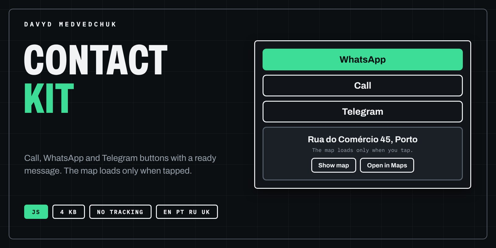

# Contact kit



> **Test version.** This app is live, but I have not checked it myself yet. If you want to use it, keep that in mind.

Call, WhatsApp, Telegram and email buttons with a ready message, plus a map that loads only when someone taps it. One JavaScript file, about 4 KB gzipped, no dependencies. Made for small business sites that have to be fast on a phone.

**Generator:** open `index.html` (or the GitHub Pages link of this repo), fill in the form, copy the snippet.

## Use it

```html
<script src="contact-kit.js" defer></script>
<contact-kit
  phone="+351 912 345 678"
  whatsapp="+351 912 345 678"
  telegram="brightside"
  message="Hello, I would like a quote."
  address="Rua do Comércio 45, Porto"
  lat="41.1496" lon="-8.6110"
  lang="en"></contact-kit>
```

Leave an attribute out and that button is not shown.

| Attribute | What it does |
|---|---|
| `phone` | Call button (`tel:`) |
| `whatsapp` | WhatsApp chat with `message` typed in |
| `telegram` | Username (`brightside`, `@brightside`, a t.me link) or a phone number |
| `email` | Email button, `message` goes into the body, optional `subject` |
| `message` | The ready text. Empty means a default in the chosen language |
| `lang` | `en`, `pt`, `ru`, `uk`. Falls back to the page language, then English |
| `country` | Country code for numbers written without `+`. Default `351` |
| `lat`, `lon`, `address`, `zoom` | Map block |
| `layout="bar"` | Sticky bar at the bottom of the screen (no map in this mode) |
| `order` | Button order, e.g. `call,whatsapp` |
| `theme="light"` | Stay light even when the visitor uses dark mode |

Colors: set `--ck-accent`, `--ck-ink`, `--ck-bg`, `--ck-radius` on the `contact-kit` element.

## Privacy

Nothing is requested from another site while the page loads. No cookies, no analytics, no fonts, no icons from a CDN. The map is a placeholder until the visitor taps "Show map"; only then the page loads an OpenStreetMap embed. "Open in Maps" is a normal link.

Tapping WhatsApp or Telegram opens those apps, so of course they learn what the visitor sends them. That part is theirs, not the page's.

## Link formats

- WhatsApp: `https://wa.me/<number>?text=<message>`. The number is international, digits only, no `+`, spaces or leading zeros.
- Telegram: `https://t.me/<username>?text=<message>`. For a phone number: `https://t.me/+<number>`.
- The kit turns `912 345 678`, `0912345678`, `+351 912 345 678` and `00351912345678` into the same number.

## Tests

```
pip install playwright && playwright install chromium
python tests/test_kit.py
```

Checks the link building, the rendered buttons in four languages, that nothing third-party loads on page load, that the map frame appears only after a tap, and that the generator's one-file download works.

## Limits

- Telegram supports a ready message in links to usernames; some older Telegram clients ignore it.
- The map needs `lat` and `lon`. The kit does not look addresses up, because that would send them to a geocoding service.
- Sticky bar mode hides the map to keep the bar small.
- Tested in headless Chromium. Not yet tried on a real phone.

MIT. Made by [Davyd Medvedchuk](https://github.com/davydmedvedchuk).
